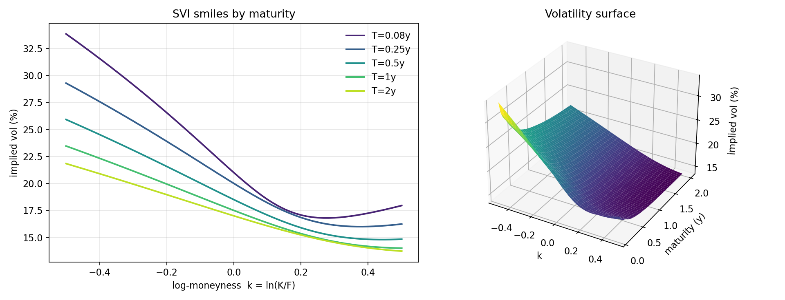

# Kairos Vol · 期权波动率研究库

[](https://github.com/Bruce848647703/kairos-vol/actions/workflows/ci.yml)

> **从报价到波动率交易的完整链路**：SVI 逐期限校准 → SSVI 全局参数化 → 无套利体检 →
> Dupire 局部波动率 → 方差互换与 carry → 期权 PnL 归因。

零第三方依赖（`numpy` + 标准库），57 个测试 + GitHub Actions CI，固定随机种子可复现。

---

## 1. 为什么需要它

Black-Scholes 假设波动率是一个常数。真实市场里，波动率随行权价变化（微笑/偏斜）、
随期限变化（期限结构）、并且**不是任意形状都合法**——一条能拟合市场的曲线，如果
违反了蝶式或日历约束，就意味着存在负的概率密度或负的远期方差，任何基于它的定价与
对冲都会系统性出错。

这个库只做一件事：**在只依赖 numpy 的前提下，把一条期权报价变成可以放心求导、
可以放心做二阶差分、可以放心反推局部波动率的曲面**，并把「模型错配」量化出来。



（`examples/plot_surface.py` 生成：左图 5 个期限的微笑，右图整个曲面。合成参数
`ρ=-0.6, η=0.8, γ=0.3`。）

## 2. 快速开始

```bash
git clone https://github.com/Bruce848647703/kairos-vol && cd kairos-vol
python -m pip install -e ".[dev]"

python -m kairos_vol                                  # 合成曲面 -> 校准 -> 体检 -> 方差互换
python -m kairos_vol price --spot 100 --strike 100 --vol 0.2
python -m kairos_vol iv --price 10 --forward 100 --strike 100 --t 1
python -m kairos_vol calibrate --csv quotes.csv       # 真实报价校准 + 无套利报告
python -m kairos_vol surface --csv quotes.csv --t 1.0 # 打印 IV 网格
```

CSV 只需要四列：`maturity, strike, iv, forward`（可选 `weight, kind`），
也兼容 `t / K / vol / F` 等别名。

## 3. 模块

| 模块 | 内容 |
|---|---|
| `core` | Black-76 / Black-Scholes、解析 Delta/Gamma/Vega/Theta、平价套利与远期反解 |
| `implied` | 隐含波动率（Newton + 二分保护）、向量化求解、坏点记 NaN |
| `svi` | 单期限 SVI（5 参数）、解析导数、Durrleman 蝴蝶条件、加权校准 |
| `ssvi` | 全局 SSVI（3 参数：ρ, η, γ）、充分无套利条件、多期限联合校准 |
| `surface` | 报价 → 逐期限 SVI → 总方差沿期限插值；ATM / 25Δ 查询、网格导出 |
| `arbitrage` | 蝶式 / 日历检验、曲面体检报告、Breeden-Litzenberger 风险中性密度 |
| `localvol` | Dupire 局部方差/波动率（总方差形式）、局部波动率网格 |
| `variance` | 对数合约复制法公允方差、已实现方差、方差互换 PnL、vol carry、期限结构 |
| `hedging` | 期权 PnL 归因：Delta / Gamma / Vega / Theta + 未解释项 |
| `data` | 合成 SSVI 报价、CSV 读写 |

## 4. 数学要点

**SVI**（Gatheral 2004）在 `k = ln(K/F)`、总方差 `w = σ²T` 下：

```
w(k) = a + b·( ρ(k−m) + sqrt((k−m)² + σ²) )
```

蝶式无套利等价于 Durrleman 条件 `g(k) ≥ 0`，其中

```
g(k) = (1 − k·w′/(2w))² − (w′/4)(1/w + 1/4) + w″/2
```

**SSVI**（Gatheral & Jacquier 2014）用 3 个全局参数描述整条曲面：

```
w(k, θ) = θ/2 · [ 1 + ρ·φ(θ)·k + sqrt((φ(θ)k + ρ)² + (1−ρ²)) ],  φ(θ) = η/θ^γ
```

充分无套利条件：`|ρ|<1`、`η(1+|ρ|) ≤ 2`、`0 < γ < 1/2`。

**Dupire 局部波动率**（总方差形式）：

```
σ_loc² = (∂w/∂T) / [ 1 − (k/w)w_k + ¼(−¼ − 1/w + k²/w²)w_k² + ½·w_kk ]
```

**方差互换**：对数合约复制

```
E[Var] = 2/T · [ ∫_{K<F} P(K)/K² dK + ∫_{K>F} C(K)/K² dK ]
```

## 5. 校准质量（`python -m kairos_vol`）

用 SSVI 生成 105 条报价，再用**逐期限 SVI** 去拟合，最后用 SSVI 反推全局参数：

```
T       ATM     k=-.25    k=+.25     SVI(a, b, rho, m, sigma)
0.080  21.00%   27.86%    16.83%    +0.00113 0.0077 -0.600 +0.138 0.1838
0.250  20.00%   24.85%    16.41%    +0.00320 0.0159 -0.600 +0.188 0.2512
0.500  18.50%   22.33%    15.46%    +0.00548 0.0232 -0.600 +0.221 0.2951
1.000  17.50%   20.55%    14.95%    +0.00980 0.0349 -0.600 +0.264 0.3514
2.000  17.00%   19.45%    14.86%    +0.01850 0.0544 -0.600 +0.319 0.4252

无套利体检: 是（每档 g_min > 0，日历 min Δw = +0.0040）

SSVI 拟合: rho=-0.6000  eta=0.8000  gamma=0.3000
（真参数:  rho=-0.6000  eta=0.8000  gamma=0.3000，最大总方差误差 4.7e-08）
```

方差互换与局部波动率（同一曲面）：

| T | ATM vol | 公允 vol | carry(var) | σ_loc(ATM) |
|---:|---:|---:|---:|---:|
| 0.08 | 21.00% | 21.34% | +0.00143 | 19.47% |
| 0.25 | 20.00% | 20.46% | +0.00187 | 19.44% |
| 0.50 | 18.50% | 19.04% | +0.00204 | 16.79% |
| 1.00 | 17.50% | 18.18% | +0.00242 | 16.35% |
| 2.00 | 17.00% | 17.91% | +0.00318 | 16.37% |

公允方差始终高于平值方差：负偏斜 + 微笑凸性 → **做空平值波动率是要付 carry 的**。
局部波动率低于平值波动率，因为 ATM 波动率随期限下降。

## 6. Python API

```python
import numpy as np
import kairos_vol as kv

# 1) 从报价拟合曲面
quotes = kv.load_quotes_csv("quotes.csv")
surface = kv.VolSurface.fit(quotes)
surface.atm_vol(1.0)                       # 平值波动率
surface.iv_at(95.0, 0.5)                   # 任意行权价/期限

# 2) 无套利体检
report = kv.surface_report(surface)
assert report["arbitrage_free"]
density = kv.risk_neutral_density(surface, 1.0)

# 3) 局部波动率与方差互换
kv.dupire_local_vol(surface, k=0.0, maturity=1.0)
kv.fair_vol_strike(surface, 1.0)
kv.vol_carry(surface, 1.0)["carry_variance"]

# 4) 期权 PnL 归因（今天的曲面 vs 明天的曲面）
row = kv.explain_pnl(100, 101, surface, tomorrow, strike=100, t0=0.5, t1=0.497)
print(row["delta"], row["gamma"], row["vega"], row["theta"], row["unexplained"])
```

单点工具：

```python
kv.black_scholes(100, 100, 1.0, 0.02, 0.2)          # 价格 + 5 个希腊字母
kv.implied_vol(10.0, 100, 100, 1.0, 1.0, "call")    # 反解 IV
kv.SVISlice.fit(k, w)                               # 单期限 SVI
kv.SSVISurface.fit([(theta, k, w), ...])            # 全局 SSVI
```

## 7. 设计取舍

**为什么不用 scipy**
: 整个库只依赖 `numpy` + `math`：正态分布用 `math.erf`，优化用自写的 Nelder-Mead，
  梯形积分用 `np.trapezoid`（老版本回退 `np.trapz`）。装完就能跑，也便于审计。

**校准为什么稳定**
: SVI 的 `(a, b)` 在固定 `(ρ, m, σ)` 时是**线性参数**，所以先做网格搜索 + 线性最小二乘
  得到好的初值，再用 Nelder-Mead 在无约束变换空间（`b=e^x, ρ=tanh x, σ=e^x`）精修。
  全程无随机数，同一份数据永远得到同一组参数。

**插值口径**
: 期限之间在**固定 k 上对总方差线性插值**，保证不会插出负方差；端点平坦外推。
  逐档 SVI + 线性插值在档位之间不保证绝对无套利，所以另提供 SSVI 全局参数化
  （其充分条件可以直接检查）。

**已知边界**
: Dupire 在期限档位上用割线近似 `∂w/∂T`；风险中性密度对数值二阶差分敏感，
  深虚值处会有少量噪声。这些在 `arbitrage.py` / `localvol.py` 里都有注释。

## 8. 项目结构

```
kairos_vol/
├── core.py         Black-76 / Black-Scholes + 希腊字母
├── implied.py      隐含波动率求解
├── svi.py          单期限 SVI + 校准
├── ssvi.py         全局 SSVI + 校准
├── surface.py      报价 -> 曲面
├── arbitrage.py    蝶式 / 日历 / 密度
├── localvol.py     Dupire
├── variance.py     方差互换 / carry
├── hedging.py      PnL 归因
├── data.py         合成报价 / CSV
└── cli.py          命令行
tests/              57 个测试
examples/           4 个可运行示例（含绘图）
```

## 9. 测试

```bash
python -m pytest          # 57 passed
```

覆盖：BS/Black-76 一致性、希腊字母有限差分校验、IV 往返（看涨/看跌 × 3 个行权价 ×
3 个波动率）、SVI/SSVI 参数还原、导数与差分一致、蝶式/日历违规检测、密度积分、
Dupire 在平坦曲面退化为常数、方差互换在平坦曲面等于 σ²、PnL 归因残差、CSV 往返、CLI 全链路。

## 10. 免责

研究与教学用途，不构成投资建议。合成数据来自 SSVI；真实报价的质量决定校准结果的质量，
上生产前请先跑 `check_quotes` 与 `surface_report`。

## 许可

MIT © 2026 Bruce848647703.

---

> **Kairos 系列**：[总索引](https://github.com/Bruce848647703/kairos) ·
> [kairos-data](https://github.com/Bruce848647703/kairos-data) ·
> [kairos-backtest](https://github.com/Bruce848647703/kairos-backtest) ·
> [kairos-factor](https://github.com/Bruce848647703/kairos-factor) ·
> [kairos-portfolio](https://github.com/Bruce848647703/kairos-portfolio) ·
> [kairos-risk](https://github.com/Bruce848647703/kairos-risk) ·
> [kairos-ml](https://github.com/Bruce848647703/kairos-ml) ·
> [kairos-strategies](https://github.com/Bruce848647703/kairos-strategies) ·
> [kairos-execution](https://github.com/Bruce848647703/kairos-execution) ·
> [kairos-crypto](https://github.com/Bruce848647703/kairos-crypto) ·
> [kairos-lab](https://github.com/Bruce848647703/kairos-lab) ·
> [kairos-research](https://github.com/Bruce848647703/kairos-research) ·
> [kairos-terminal](https://github.com/Bruce848647703/kairos-terminal) ·
> **[kairos-vol](https://github.com/Bruce848647703/kairos-vol)**